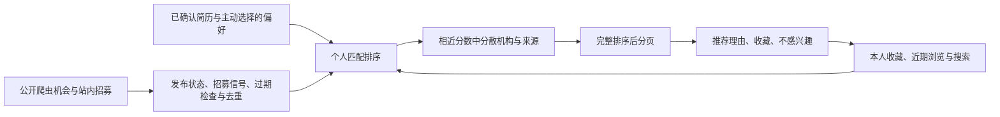

# 暑研通推荐算法设计与首版实现

目标是帮助学生尽快找到值得核对和申请的机会，减少重复检索、无关信息和材料搬运。推荐结果应能回答“为什么给我看这个”，不能把排序分数解释为录取概率。当前版本编号为 `content-feedback-v1`，权重是待验证的产品假设，还没有用真实申请结果训练。

## 已接入的流程

这种“候选筛选—评分—重排”的分层是推荐系统的常用结构；本项目的具体信号、权重和界面如下自行定义。[Google 推荐系统结构说明](https://developers.google.com/machine-learning/recommendation/overview/types)

首页提供“为你推荐”和“按发布时间”。主动搜索继续遵守用户输入的查询条件，不会因为浏览历史而偷偷放宽条件。原来的“我的简历优先”仍是单独的纯简历匹配模式。

## 首版评分

各信号先归一化为 0–1，内部总分为：

`35 × 简历 + 25 × 主动偏好 + 15 × 收藏/浏览兴趣 + 5 × 近期搜索 + 8 × 来源 + 7 × 内容质量 + 5 × 发布时间`

这是初始排序规则，不是训练出来的预测模型。缺失信号记为 0，界面显示理由而非个人适配百分比。

| 信号 | 目前怎样计算 | 为什么这样做 |
| --- | --- | --- |
| 简历 | 只用用户确认的技能和方向；需同时有简历与项目正文依据 | 不从姓名、年龄或学校名气推断能力 |
| 稀有方向 | `IDF = 1 + ln((1+候选数)/(1+提及该词的候选数))`；按 IDF 加权计算共同词占比 | 在当前候选里少见的专业术语比泛词更能区分方向 |
| 主动偏好 | 沿用研究方向、专业、申请类型与地区的规则，归一化后最多 25 分 | 用户明确选择应比偶然浏览更有影响；地区只是软偏好 |
| 当前收藏 | 最新 50 个仍在候选目录中的收藏，每个项目权重 4，再均分到其方向/技能 | 收藏是明确兴趣；取消收藏后立即移除这部分影响 |
| 近期浏览 | 最近 90 天，每个项目只贡献一次；权重 `2^(-天数/30)`，最近一次为 1 | 重复刷新不会制造强偏好，旧兴趣逐渐减弱 |
| 兴趣置信度 | 收藏/浏览总权重不足 8 时按比例缩小，整个分项最多 15 分 | 一次误点不应改写整页推荐 |
| 近期搜索 | 最近 20 条搜索中，相同查询去重，整词/中文片段命中，30 天半衰期 | 只做小幅辅助，整个分项最多 5 分 |
| 来源与内容质量 | 来源权重复用现有表，质量值限制在 0–100 | 有原文可追溯仍需核对，官方来源并不等于已经验证全部条件 |
| 发布时间 | 60 天半衰期；未知发布时间不加分，不把重新采集时间当发布时间 | 避免重复采集让旧帖子看起来像新机会 |

收藏和浏览兴趣采用加权共同主题占比，并使用上面的置信度修正。稀有词权重在去重后的可见候选上计算，因此隐藏机会、目录更新后可能有小幅变化。

冷启动时没有足够个人信息，就按来源、质量、已知发布时间提供发现机会；不编造“与你相似的人都申请了”。默认也不根据学校档次、学历、姓名或敏感属性降低用户看到机会的资格。

## 防止重复和失真

共享检查先排除未公开招募、讨论/经验帖、个人主页和已明确过期的机会。相同来源链接或相同标题加机构合并；被隐藏项目的可识别副本一起隐藏，独立来源链接仍保留在搜索中。

前 200 项做一次轻量重排：每次只查看接下来 20 项，候选基础分距当前首项最多 8 分；对最近 5 条里重复的机构和来源扣少量排序权重。它只打散相近结果，不强制塞入明显不相关的项目。后续候选完整保留，再统一分页。多样性和新鲜度可以通过重排处理，但是否改善申请体验仍需要实测。[Google 重排说明](https://developers.google.com/machine-learning/recommendation/dnn/re-ranking)

“不感兴趣”只隐藏首页的项目，不自动否定整个研究方向。可恢复隐藏机会。用户可以关闭浏览/搜索记录的采集和使用，或单独清除记录；简历和收藏保持独立。清除之后，后续主动浏览会产生新的记录，彻底暂停需关闭开关。

## 数据与成本

复用 `opportunities`、`user_profiles`、`user_resumes`、`user_saved`、`user_behaviors`，增加一张只存行为学习开关的 `recommendation_settings`。不接付费模型、消息队列、向量数据库或云端画像服务。

新浏览/搜索按用户、动作、目标、UTC 日期去重；新写入时清理超过 90 天的数据并限制为最近 200 条，排序最多取最近 100 条。停用用户的旧记录不会被重新用于推荐，可主动清除。隐藏反馈只记录项目 ID，不记录邮件、附件、简历正文、停留时间或滚动轨迹；旧版本已有的其他行为记录不参与本算法。

共享缓存只存公开项目正文与固定主题标签，最多 512 项、每项最多 20000 字符；更长正文仍完整计算但不缓存。正文变化自动使用新缓存键。自定义简历词、简历正文和用户历史只在该次请求中参与计算，不进入共享缓存。个性页面禁止共享缓存，反馈写入需本人登录与 CSRF 校验。

已修复取消收藏未提交的问题，并为收藏和反馈入口补上验证；站内招募的浏览也会走同一条记录逻辑。

## 数据多了以后如何升级

以下是后续方案，当前未启用：

1. **先验证内容推荐是否有用。** 让试用者标注前 10 条里的相关、无关、资格未知，以及判断所花时间；按研究方向、中英文、新老用户与来源分别看结果。以有效收藏和有准备的申请为目标，不追求页面停留时长。
2. **积累可信反馈后做物品协同推荐。** 以去重后的项目为节点，用明确同意用于群体分析的用户收藏构建共现关系；使用相似度归一化与小样本收缩，候选关系至少有 5 位不同用户支持才展示，并抑制单账号重复操作。5 是初始隐私与小样本门槛，不是已验证的最佳参数；不向他人显示谁收藏了什么。群体推荐不能突破用户筛选或隐藏设置。
3. **再考虑学习排序。** 先补足获同意的曝光位置、算法版本、候选快照和后续反馈，按时间切分训练/验证，避免用未来行为算过去的画像。用同一时点的目录和用户状态重放，比较规则基线与轻量排序模型的 Precision@10、NDCG@10、隐藏率及方向/来源覆盖；没有曝光记录时，不把“没点过”当负样本，也不声称有可靠点击率。
4. **流量和延迟决定基础设施。** 先预计算公开项目特征、做增量更新和倒排召回；只有本机性能与数据规模证明需要时，再迁移数据库、增加任务队列或近邻索引。用户行为与特征覆盖不足时，不训练双塔或购买大模型调用额度。

发布前回归重点：过期/隐藏/跨用户隔离、收藏撤销、重复点击、时间衰减、稀有方向、个人属性不改变排名、多样性、超过 200 条后的完整分页。性能只报告实际测量条件，不把单机小目录结果外推成大规模吞吐能力。

本机只读测量：目录中 373 条带网页链接的记录，过滤、去重后 169 条可推荐；使用 8 个测试简历词，首次公开特征计算约 4.44 秒，缓存命中后约 0.65 秒。各测量一次，不是 P95，也不包含页面渲染或网络时间。冷启动开销仍是后续优化点。

当前匹配仍依赖词、别名和保守的否定表达过滤，不能完全理解复杂跨句条件或研究深度。资格未知仍需用户核对原文；有真实失败案例后再决定是否增加语义模型。

完成验证：136 项离线回归测试通过；浏览器使用临时账号检查了收藏后理由更新、隐藏机会与恢复入口。测试与预览均使用独立数据库，没有发送真实邮件。
